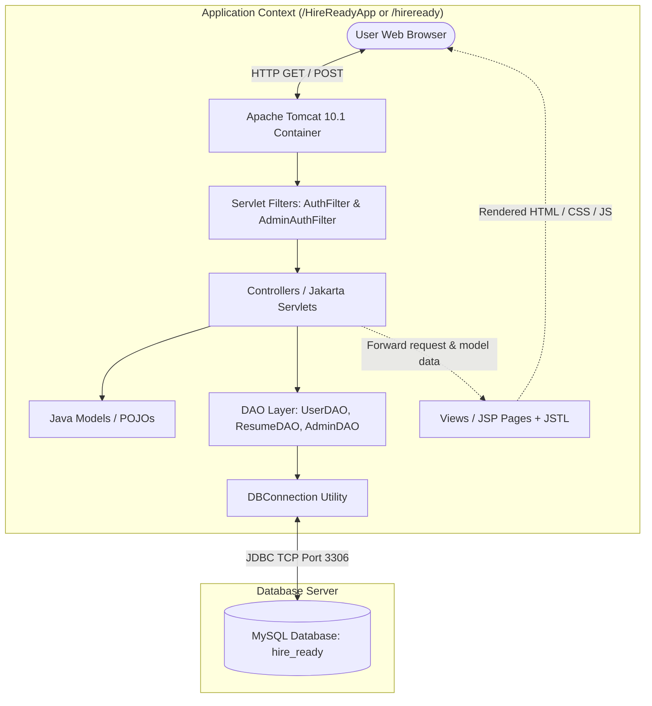
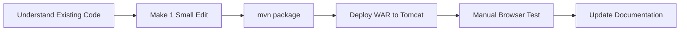

# PROJECT DOCUMENTATION — HireReady
**HireReady: Online Resume Builder and Career System**  
*Project Location: `C:\Users\simra\OneDrive\Desktop\HireReady-New`*  
*Target Environment: Java 17+, Jakarta EE 10, Apache Tomcat 10.1, MySQL 8.0, Apache Maven 3.9*  
*Document Version: 1.0.0 | Last Verified: October 2026*

---

## TABLE OF CONTENTS
1. [Section 1 — Project Overview](#section-1--project-overview)
2. [Section 2 — Technology Stack](#section-2--technology-stack)
3. [Section 3 — Complete Project Folder Structure](#section-3--complete-project-folder-structure)
4. [Section 4 — Application Architecture](#section-4--application-architecture)
5. [Section 5 — Complete User Workflow](#section-5--complete-user-workflow)
6. [Section 6 — Database Documentation](#section-6--database-documentation)
7. [Section 7 — Resume Creation and Update Logic](#section-7--resume-creation-and-update-logic)
8. [Section 8 — Important Java Classes and Methods](#section-8--important-java-classes-and-methods)
9. [Section 9 — Build Process Using Maven](#section-9--build-process-using-maven)
10. [Section 10 — Tomcat Deployment](#section-10--tomcat-deployment)
11. [Section 11 — Errors We Have Faced and Their Fixes](#section-11--errors-we-have-faced-and-their-fixes)
12. [Section 12 — Testing Documentation](#section-12--testing-documentation)
13. [Section 13 — How to Make Future Changes](#section-13--how-to-make-future-changes)
14. [Section 14 — Command Reference](#section-14--command-reference)
15. [Section 15 — Project Status and Next Steps](#section-15--project-status-and-next-steps)
16. [Section 16 — Viva and Interview Preparation](#section-16--viva-and-interview-preparation)
17. [Documentation Maintenance & Change Log](#documentation-maintenance--change-log)

---

## SECTION 1 — PROJECT OVERVIEW

### 1.1 What is HireReady?
**HireReady** is a web-based **Online Resume Builder and Career Management System** written in Java. It allows students and job seekers to register accounts, log in, create structured professional resumes, update them, preview them in an authentic A4 format, and export them directly to PDF using their browser's native print engine. It also provides an eligibility search feature where recruiters or users can filter candidate resumes based on criteria like minimum CGPA, degree, skills, and graduation year.

### 1.2 What Problem Does It Solve?
1. **Unstructured Resumes:** Students and fresh graduates often create resumes with inconsistent formatting, poor layout choices, and missing sections. HireReady provides a guided, multi-section web form that structures personal data, education, technical skills, and projects uniformly.
2. **Difficult Filtering for Recruiters:** In campus recruitment or company drives, reviewing hundreds of individual PDF/Word documents is time-consuming. HireReady stores candidate qualifications in relational database tables, enabling parameterized SQL searches (e.g., "Find all candidates with B.Tech, CGPA >= 8.0, with Java skills").
3. **Multi-profile Management:** A job seeker often needs different resumes for different roles (e.g., "Java Backend Developer" vs. "Frontend Web Specialist"). HireReady allows a user to maintain multiple distinct resumes under a single account.

### 1.3 Intended Users
* **Students & Job Seekers:** Register an account, create and customize multiple resumes, edit qualifications, and export print-ready resumes.
* **Campus Recruiters / Placement Cells:** Search the candidate database using eligibility criteria to shortlist qualified applicants.
* **Administrators:** Monitor registered accounts, oversee total resume volume, and moderate inappropriate or invalid entries.

### 1.4 Main Purpose of the Application
The primary goal is to provide a clean, secure, and relational resume management platform built on core Java enterprise technologies (**Jakarta Servlets, JSP, JDBC, MySQL**) without depending on heavy third-party web frameworks like Spring Boot. This makes it an ideal reference project for understanding foundational enterprise Java and MVC design principles.

### 1.5 Features Confirmed Actually Implemented
| Feature | Implementation Status | Notes |
|---|---|---|
| **User Registration** | **IMPLEMENTED** | Form validation, duplicate email check, BCrypt password hashing. |
| **User Login & Session** | **IMPLEMENTED** | Authenticates against `users` table; maintains session (`userId`, `userName`). |
| **User Logout** | **IMPLEMENTED** | Invalidates HTTP session and cleans cookies. |
| **Protected Route Filters** | **IMPLEMENTED** | `AuthFilter` protects `/dashboard`, `/resumes`, `/resume/*`, `/filter`. |
| **User Dashboard** | **IMPLEMENTED** | Displays welcome banner, resume counts, and user's resumes. |
| **Resume Creation** | **IMPLEMENTED** | Saves `resume_title`, `summary`, `career_objective` to `resumes`. |
| **Dynamic Education Rows** | **IMPLEMENTED** | Repeater UI in JS; saves multiple education rows to `education`. |
| **Dynamic Skills Rows** | **IMPLEMENTED** | Repeater UI in JS; saves skills to `skills` table. |
| **Dynamic Projects Rows** | **IMPLEMENTED** | Repeater UI in JS; saves projects to `projects` table. |
| **Resume Preview & Print** | **IMPLEMENTED** | Dedicated A4 CSS paper layout; `@media print` cleans buttons and bars. |
| **Resume Edit & Update** | **IMPLEMENTED** | Updates header and replaces child records inside a transaction. |
| **Resume Delete** | **IMPLEMENTED** | Enforces user ownership (`WHERE resume_id = ? AND user_id = ?`). |
| **Eligibility Filtering** | **IMPLEMENTED** | Parameterized query filtering by CGPA, Degree, Skill, and Year. |
| **Admin Portal** | **PARTIAL / CODE PRESENT** | Admin servlets and JSPs exist; requires `admins` table in database. |
| **Work Experience Table** | **INCOMPLETE / UI ONLY** | Form inputs exist; skipped in DAO because table not in `hire_ready`. |
| **Certifications Table** | **INCOMPLETE / UI ONLY** | Form inputs exist; skipped in DAO because table not in `hire_ready`. |
| **Achievements Table** | **INCOMPLETE / UI ONLY** | Form inputs exist; skipped in DAO because table not in `hire_ready`. |

### 1.6 Technologies Used and Why
* **Java 17 / Jakarta EE 10:** Modern LTS standard offering high performance, modern syntax, and long-term stability.
* **Jakarta Servlets 6.0:** Lightweight, low-overhead HTTP controllers that handle GET and POST requests, validate input, invoke DAOs, and route views.
* **JSP (JavaServer Pages) 3.1 & JSTL 3.0:** Server-side view rendering that separates HTML markup from Java business logic using expression language (`${...}`) and tags (`<c:forEach>`, `<c:if>`).
* **JDBC (Java Database Connectivity):** Direct database communication using `PreparedStatement` to prevent SQL injection and manage explicit atomic transactions (`commit` and `rollback`).
* **MySQL 8.0:** Robust, widely supported relational database for storing normalized relational data.
* **Apache Maven 3.9:** Automates dependency resolution, compilation, and WAR packaging.
* **Apache Tomcat 10.1:** Jakarta EE 10 compatible servlet container hosting the web application.
* **jBCrypt 0.4:** One-way salted hashing to protect user passwords against credential leaks.
* **Vanilla CSS3 & Modern JavaScript:** Fast, responsive layout with zero heavy UI library dependencies (no Node.js build step needed).

### 1.7 Architectural Components in this Project
In this project, responsibilities are clearly divided into four distinct tiers:
1. **Frontend (Browser Client):** JSP pages rendered to HTML5, styled with `style.css`, and made interactive with `main.js` (adding/removing rows, auto-closing alerts).
2. **Backend (Application Layer):** Java Servlets act as Controllers receiving HTTP requests. Utility classes (`PasswordUtil`, `ValidationUtil`) sanitize data, and Java Models encapsulate entities.
3. **Data Access (DAO Tier):** Classes (`UserDAO`, `ResumeDAO`, `AdminDAO`) execute JDBC queries against MySQL using `PreparedStatement`.
4. **Database (Data Tier):** The MySQL relational database (`hire_ready`) stores persistent data across multiple tables.
5. **Application Server (Servlet Container):** Apache Tomcat 10.1 manages the lifecycle of Servlets and JSPs, HTTP sessions, and connection threading.

### 1.8 Simple Architecture Diagram


---

## SECTION 2 — TECHNOLOGY STACK

| Technology | Version in Project | Purpose / Role | Why It Is Used |
|---|---|---|---|
| **Java Development Kit (JDK)** | Java 17 target (Run on JDK 25) | Core Programming Language | Strong type safety, multithreading, and enterprise stability. |
| **Jakarta Servlet API** | 6.0.0 (`jakarta.servlet.*`) | Controller Layer | Handles HTTP requests, manages sessions, and dispatches responses. |
| **Jakarta JSP API** | 3.1.0 (`jakarta.servlet.jsp.*`) | View Layer | Embeds dynamic data inside standard HTML templates. |
| **Jakarta JSTL** | 3.0.0 (GlassFish 3.0.1) | Presentation Logic | Clean looping (`<c:forEach>`) and conditional rendering (`<c:if>`) without raw Java scriptlets. |
| **MySQL Connector/J** | 8.3.0 | JDBC Database Driver | Translates Java JDBC calls into MySQL network wire protocol packets. |
| **MySQL Server** | 8.0.x / 9.x | Relational Database Engine | Stores relational tables with foreign keys and indexes. |
| **Apache Maven** | 3.9+ | Build and Dependency Tool | Resolves JAR dependencies from Maven Central and compiles source code into a WAR archive. |
| **Apache Tomcat** | 10.1.x | Web Container / Server | Implements the Jakarta Servlet 6.0 and JSP 3.1 specifications. |
| **jBCrypt** | 0.4 | Password Security | Computes salted, slow one-way cryptographic hashes for passwords. |
| **HTML5 & CSS3** | Standard | User Interface & Print Engine | Semantic layouts, flexbox, grid, and CSS `@media print` rules. |
| **Vanilla JavaScript** | ES6 Standard | Client-Side Interactivity | Repeats input rows dynamically and triggers `window.print()`. |
| **XML (`web.xml`)** | 6.0 Specification | Deployment Descriptor | Defines session timeouts, error pages, and filter URL patterns. |

### How These Technologies Communicate
1. The **Browser** issues an HTTP GET or POST request to Tomcat on port `8080`.
2. **Tomcat 10.1** routes the request through any matching **Filters** (`AuthFilter`).
3. If allowed, Tomcat invokes the target **Servlet** (Controller).
4. The **Servlet** calls `request.getParameter(...)`, validates inputs with `ValidationUtil`, and builds **Model** objects.
5. The Servlet calls methods on **DAO** classes (`UserDAO`, `ResumeDAO`).
6. The DAO calls `DBConnection.getConnection()`, which uses **MySQL Connector/J** to open a TCP socket connection to **MySQL Server** on port `3306`.
7. The DAO executes SQL queries using `PreparedStatement` and converts SQL `ResultSet` rows back into Java objects.
8. The Servlet puts these Java objects into the `HttpServletRequest` attribute map (`request.setAttribute("resumes", list)`).
9. The Servlet forwards the request to a **JSP** page (`RequestDispatcher.forward`).
10. **Tomcat** compiles the JSP into a servlet, executes JSTL tags to produce HTML, and streams the HTML back to the browser.

---

## SECTION 3 — COMPLETE PROJECT FOLDER STRUCTURE

```
HireReady-New/
├── .gitignore                          # Git ignore rules for compiled binaries and IDE cache
├── .vscode/                            # VS Code workspace settings
│   └── settings.json                   # JVM memory and language server arguments
├── database.sql                        # Idealized SQL schema script and sample data
├── pom.xml                             # Maven build configuration and dependency list
├── README.md                           # Quick-start instructions and general overview
├── PROJECT_DOCUMENTATION.md            # This complete technical documentation file
├── src/
│   └── main/
│       ├── java/
│       │   └── com/
│       │       └── hireready/
│       │           ├── controller/     # Jakarta Servlets (MVC Controllers)
│       │           │   ├── AdminDashboardServlet.java
│       │           │   ├── AdminLoginServlet.java
│       │           │   ├── AdminLogoutServlet.java
│       │           │   ├── AdminResumeDeleteServlet.java
│       │           │   ├── AdminUserDeleteServlet.java
│       │           │   ├── DashboardServlet.java
│       │           │   ├── HomeServlet.java
│       │           │   ├── LoginServlet.java
│       │           │   ├── LogoutServlet.java
│       │           │   ├── RegisterServlet.java
│       │           │   ├── ResumeCreateServlet.java
│       │           │   ├── ResumeDeleteServlet.java
│       │           │   ├── ResumeEditServlet.java
│       │           │   ├── ResumeFilterServlet.java
│       │           │   ├── ResumeListServlet.java
│       │           │   └── ResumeViewServlet.java
│       │           ├── dao/            # Data Access Objects (JDBC database queries)
│       │           │   ├── AdminDAO.java
│       │           │   ├── ResumeDAO.java
│       │           │   └── UserDAO.java
│       │           ├── filter/         # Security and session interceptors
│       │           │   ├── AdminAuthFilter.java
│       │           │   └── AuthFilter.java
│       │           ├── model/          # Java Entity POJOs (Plain Old Java Objects)
│       │           │   ├── Achievement.java
│       │           │   ├── Admin.java
│       │           │   ├── Certification.java
│       │           │   ├── Education.java
│       │           │   ├── Experience.java
│       │           │   ├── FilterCriteria.java
│       │           │   ├── Project.java
│       │           │   ├── Resume.java
│       │           │   ├── Skill.java
│       │           │   └── User.java
│       │           └── util/           # Common helpers
│       │               ├── DBConnection.java
│       │               ├── PasswordUtil.java
│       │               └── ValidationUtil.java
│       ├── resources/
│       │   └── db.properties           # Centralized MySQL credentials and JDBC URL
│       └── webapp/                     # Web root deployed to Tomcat
│           ├── admin-dashboard.jsp     # Administrator user and resume console
│           ├── admin-login.jsp         # Administrator login form
│           ├── dashboard.jsp           # Main candidate dashboard
│           ├── filter.jsp              # Eligibility search interface
│           ├── index.jsp               # Landing page / home page
│           ├── login.jsp               # Candidate login form
│           ├── register.jsp            # Candidate registration form
│           ├── resume-form.jsp         # Unified Create/Edit resume builder form
│           ├── resume-list.jsp         # Dedicated list of candidate resumes
│           ├── resume-view.jsp         # Clean A4 printable resume preview
│           ├── css/
│           │   └── style.css           # Global typography, themes, and print rules
│           ├── js/
│           │   └── main.js             # Dynamic repeater row generator & print trigger
│           ├── error/
│           │   ├── 404.jsp             # Friendly Not Found error page
│           │   └── 500.jsp             # Friendly Server Error page
│           └── WEB-INF/
│               ├── web.xml             # Deployment descriptor (Filters, timeouts, errors)
│               └── views/
│                   └── common/
│                       ├── alerts.jsp  # Flash alert notification banner
│                       ├── footer.jsp  # Shared footer component
│                       └── navbar.jsp  # Shared navigation bar component
└── target/                             # Maven build output directory
    ├── classes/                        # Compiled .class files and packaged db.properties
    └── hireready.war                   # Final packaged Web Application Archive
```

### Detailed Component Inventory

#### 1. Controllers (`com.hireready.controller`)
* **`HomeServlet.java` (`/`, `/home`):**
  * *Responsibility:* Dispatches users to the landing page (`index.jsp`).
  * *Receives:* HTTP GET.
  * *Returns:* Forwards to `/index.jsp`.
* **`RegisterServlet.java` (`/register`):**
  * *Responsibility:* Handles user account registration.
  * *Receives:* `fullName`, `email`, `password`, `confirmPassword`.
  * *Returns:* On success, redirects to `/login.jsp` with flash message. On failure, returns to `/register.jsp` with error.
  * *Interacts with:* `UserDAO`, `ValidationUtil`, `PasswordUtil`.
* **`LoginServlet.java` (`/login`):**
  * *Responsibility:* Authenticates candidate credentials and initializes session.
  * *Receives:* `email`, `password`.
  * *Returns:* Redirects to `/dashboard` on success; forwards to `/login.jsp` on failure.
  * *Interacts with:* `UserDAO`, `PasswordUtil`.
* **`LogoutServlet.java` (`/logout`):**
  * *Responsibility:* Cleans up session attributes and calls `session.invalidate()`.
  * *Receives:* GET/POST.
  * *Returns:* Redirects to `/login.jsp` with logout confirmation.
* **`DashboardServlet.java` (`/dashboard`):**
  * *Responsibility:* Loads user's resumes and total count, then renders dashboard.
  * *Receives:* Active session `user`.
  * *Returns:* Forwards to `/dashboard.jsp` with `resumes` and `resumeCount`.
  * *Interacts with:* `ResumeDAO`.
* **`ResumeCreateServlet.java` (`/resume/create`):**
  * *Responsibility:* GET renders blank builder form. POST parses header and arrays of education, skills, and projects, saving them via `ResumeDAO`.
  * *Receives:* Form data (header fields + arrays `degree[]`, `institution[]`, `skillNames[]`, etc.).
  * *Returns:* Redirects to `/resume/view?id={newId}` on success; forwards to form on error.
  * *Interacts with:* `ResumeDAO`, `Resume`, `Education`, `Skill`, `Project`.
* **`ResumeEditServlet.java` (`/resume/edit`):**
  * *Responsibility:* GET loads existing resume for editing (verifying user ownership). POST updates resume header and child collections.
  * *Receives:* GET `id`, POST form fields + `resumeId`.
  * *Returns:* Redirects to `/resume/view?id={id}` on success.
  * *Interacts with:* `ResumeDAO`.
* **`ResumeDeleteServlet.java` (`/resume/delete`):**
  * *Responsibility:* Permanently deletes a resume if owned by the logged-in user.
  * *Receives:* Parameter `id`.
  * *Returns:* Redirects to `/dashboard` with success or error message.
  * *Interacts with:* `ResumeDAO`.
* **`ResumeViewServlet.java` (`/resume/view`):**
  * *Responsibility:* Fetches complete resume including child records for display and printing.
  * *Receives:* Parameter `id`.
  * *Returns:* Forwards to `/resume-view.jsp` with attribute `resume`.
  * *Interacts with:* `ResumeDAO`.
* **`ResumeListServlet.java` (`/resumes`):**
  * *Responsibility:* Renders a dedicated page listing all resumes created by the logged-in candidate.
  * *Receives:* Active session `user`.
  * *Returns:* Forwards to `/resume-list.jsp`.
* **`ResumeFilterServlet.java` (`/filter`):**
  * *Responsibility:* Executes candidate eligibility filtering using dynamic SQL.
  * *Receives:* `minCgpa`, `degree`, `skill`, `passingYear`, `keyword`.
  * *Returns:* Forwards to `/filter.jsp` with matching `results` list and `criteria`.
  * *Interacts with:* `ResumeDAO`, `FilterCriteria`.
* **`AdminLoginServlet.java` (`/admin/login`):**
  * *Responsibility:* Authenticates administrator username and password.
  * *Interacts with:* `AdminDAO`, `PasswordUtil`.
* **`AdminDashboardServlet.java` (`/admin/dashboard`):**
  * *Responsibility:* Lists all users and all resumes across the entire system.
  * *Interacts with:* `UserDAO`, `ResumeDAO`.
* **`AdminResumeDeleteServlet.java` (`/admin/resume/delete`):**
  * *Responsibility:* Allows an administrator to delete any resume regardless of ownership.
  * *Interacts with:* `ResumeDAO`.
* **`AdminUserDeleteServlet.java` (`/admin/user/delete`):**
  * *Responsibility:* Deletes a user account and cascades delete to all associated resumes.
  * *Interacts with:* `UserDAO`.
* **`AdminLogoutServlet.java` (`/admin/logout`):**
  * *Responsibility:* Logs out administrator and clears admin session attributes.

#### 2. Data Access Objects (`com.hireready.dao`)
* **`UserDAO.java`:** Performs SQL CRUD operations on the `users` table (`register`, `findByEmail`, `findById`, `isEmailRegistered`, `getAllUsers`, `deleteUser`, `countUsers`).
* **`ResumeDAO.java`:** Performs atomic transactional operations on `resumes`, `education`, `skills`, and `projects`. Contains `createResume`, `updateResume`, `deleteResume`, `getResumeByIdAndUser`, `getResumeById`, `filterResumes`, etc.
* **`AdminDAO.java`:** Authenticates and fetches administrator accounts from the `admins` table.

#### 3. Security Filters (`com.hireready.filter`)
* **`AuthFilter.java`:** Intercepts requests to `/dashboard`, `/resumes`, `/resume/*`, and `/filter`. Verifies that `session.getAttribute("user")` is not null. Also sets HTTP headers to prevent browser caching.
* **`AdminAuthFilter.java`:** Intercepts requests to `/admin/dashboard`, `/admin/resume/*`, `/admin/user/*`. Verifies that `session.getAttribute("admin")` is present.

#### 4. Models (`com.hireready.model`)
* **`User.java`:** Entity for candidate accounts (`userId`, `fullName`, `email`, `password`, `createdAt`).
* **`Admin.java`:** Entity for administrator accounts (`adminId`, `username`, `password`, `fullName`, `email`, `createdAt`).
* **`Resume.java`:** Aggregator model holding header info (`resumeId`, `userId`, `title`, `summary`, `careerObjective`, etc.) and lists of child models (`educationList`, `skillList`, `projectList`, etc.).
* **`Education.java`:** Holds degree, institution, passing year, and CGPA.
* **`Skill.java`:** Holds category name and comma-separated skill names.
* **`Project.java`:** Holds project title, technologies, description, and repository/live link.
* **`Experience.java`:** Holds company, role, duration, and job responsibilities.
* **`Certification.java`:** Holds certification name, issuer, and year.
* **`Achievement.java`:** Holds honor/award title and description.
* **`FilterCriteria.java`:** Encapsulates search form fields (`minCgpa`, `degree`, `skill`, `passingYear`, `keyword`).

#### 5. Utilities (`com.hireready.util`)
* **`DBConnection.java`:** Reads `db.properties`, registers the MySQL Connector/J driver, dispenses JDBC connections via `getConnection()`, and silently closes resources via `close()`.
* **`PasswordUtil.java`:** Hashes plain-text passwords using BCrypt with salt rounds = 10 and checks passwords using `BCrypt.checkpw`.
* **`ValidationUtil.java`:** Validates non-empty strings, email regular expressions, minimum password lengths, and safely parses numeric inputs.

---

## SECTION 4 — APPLICATION ARCHITECTURE

HireReady follows the classic **Model-View-Controller (MVC) Pattern** coupled with the **Data Access Object (DAO) Pattern**:

```
 ┌───────────────────────────────────────────────────────────────┐
 │                       BROWSER CLIENT                          │
 │  (HTML5 Forms, style.css, main.js, A4 @media print layouts)   │
 └───────────────────────────────┬───────────────────────────────┘
                                 │ HTTP Request (GET/POST)
                                 ▼
 ┌───────────────────────────────────────────────────────────────┐
 │               CONTROLLER (Jakarta Servlets)                   │
 │  - Validates request parameters (ValidationUtil)              │
 │  - Hashes passwords if registering (PasswordUtil)             │
 │  - Populates Java Models / POJOs                              │
 │  - Calls DAO methods                                          │
 └──────────────┬────────────────────────────────▲───────────────┘
                │ Calls DAO Methods              │ Dispatches View
                ▼                                │ (RequestDispatcher.forward)
 ┌─────────────────────────────┐  ┌──────────────┴───────────────┐
 │    DAO LAYER (ResumeDAO,    │  │    VIEW LAYER (JSP + JSTL)   │
 │     UserDAO, AdminDAO)      │  │  - Renders dynamic HTML      │
 └──────────────┬──────────────┘  │  - JSTL <c:forEach>, <c:if>  │
                │ Executes SQL    └──────────────────────────────┘
                ▼
 ┌─────────────────────────────┐
 │       JDBC LAYER            │
 │  - PreparedStatement        │
 │  - Transactions / Rollback  │
 └──────────────┬──────────────┘
                │ TCP Socket (Port 3306)
                ▼
 ┌─────────────────────────────┐
 │      MySQL DATABASE         │
 │     (`hire_ready`)          │
 └─────────────────────────────┘
```

### Trace of a Real-World User Action: Saving a New Resume
To understand how these layers connect, let us follow the creation of a new resume:
1. **User Action:** The candidate fills out `resume-form.jsp` (Title: "Java Backend Engineer", Degree: "B.Tech", Skills: "Java, MySQL", Project: "HireReady") and clicks the "Save Resume" button.
2. **HTTP Transmission:** The browser issues an `HTTP POST` request to the URL `/resume/create`.
3. **Filter Interception:** `AuthFilter` checks `session.getAttribute("user")`. Since the candidate is logged in, it allows the request through.
4. **Controller Processing:** `ResumeCreateServlet.doPost(...)` executes:
   - Reads `title`, `summary`, `careerObjective`.
   - Reads array inputs `degree[]`, `institution[]`, `cgpa[]`, `skillNames[]`, `projectTitle[]`.
   - Validates that mandatory fields are present.
   - Instantiates a `Resume` object and populates its child lists (`Education`, `Skill`, `Project`).
5. **DAO Invocation:** The servlet calls `resumeDAO.createResume(resume)`.
6. **Transaction Execution:** Inside `ResumeDAO.createResume`:
   - Calls `conn.setAutoCommit(false)` to start a database transaction.
   - Executes `INSERT INTO resumes (user_id, resume_title, summary, career_objective) VALUES (?, ?, ?, ?)`.
   - Calls `psResume.getGeneratedKeys()` to retrieve the auto-generated `resume_id` (e.g., `42`).
   - Uses batch prepared statements to insert education records into `education` linking `resume_id = 42`.
   - Uses batch prepared statements to insert skills into `skills` linking `resume_id = 42`.
   - Uses batch prepared statements to insert projects into `projects` linking `resume_id = 42`.
   - If all succeed, calls `conn.commit()`. If an exception occurs, calls `conn.rollback()`.
7. **Redirection:** The servlet puts a success notice in the session and sends an HTTP redirect (`302`) to `/resume/view?id=42`.
8. **View Rendering:** `ResumeViewServlet.doGet(...)` queries `resumeDAO.getResumeByIdAndUser(42, userId)`, forwards to `resume-view.jsp`, and the candidate sees their complete formatted resume.

---

## SECTION 5 — COMPLETE USER WORKFLOW

### A. User Registration
* **User Browser Action:** Fills out Full Name, Email, Password, and Confirm Password on `/register.jsp` and clicks "Register".
* **Servlet Involved:** `RegisterServlet` (URL: `/register`, Method: `POST`).
* **Java Model:** `com.hireready.model.User`.
* **DAO Method:** `UserDAO.isEmailRegistered(email)`, then `UserDAO.register(newUser)`.
* **SQL Operation:**
  ```sql
  SELECT 1 FROM users WHERE LOWER(email) = ?;
  INSERT INTO users (full_name, email, password) VALUES (?, ?, ?);
  ```
* **Database Table:** `users`.
* **User Response:** Redirects to `/login.jsp` with a green flash alert: *"Account created successfully! You can now log in."*
* **Status:** **IMPLEMENTED AND VERIFIED IN CODE**.

### B. User Login
* **User Browser Action:** Enters registered Email and Password on `/login.jsp` and clicks "Login".
* **Servlet Involved:** `LoginServlet` (URL: `/login`, Method: `POST`).
* **Java Model:** `com.hireready.model.User`.
* **DAO Method:** `UserDAO.findByEmail(email)`.
* **Password Verification:** `PasswordUtil.verifyPassword(plainPassword, user.getPassword())`.
* **SQL Operation:**
  ```sql
  SELECT user_id, full_name, email, password, created_at FROM users WHERE LOWER(email) = ?;
  ```
* **Database Table:** `users`.
* **User Response:** Session attributes `user`, `userId`, and `userName` are stored. Browser is redirected to `/dashboard`.
* **Status:** **IMPLEMENTED AND VERIFIED IN CODE**.

### C. Opening the Dashboard
* **User Browser Action:** Navigates to `/dashboard` or is redirected after login.
* **Servlet Involved:** `DashboardServlet` (URL: `/dashboard`, Method: `GET`).
* **Filter:** `AuthFilter` ensures the session is valid and sets no-cache headers.
* **Java Model:** `List<com.hireready.model.Resume>`.
* **DAO Method:** `ResumeDAO.getResumesByUserId(userId)` and `ResumeDAO.countResumesByUser(userId)`.
* **SQL Operation:**
  ```sql
  SELECT * FROM resumes WHERE user_id = ? ORDER BY updated_at DESC;
  SELECT COUNT(*) FROM resumes WHERE user_id = ?;
  ```
* **Database Table:** `resumes`.
* **User Response:** `dashboard.jsp` displays total resume stats and a table listing all the candidate's resumes with Preview, Edit, and Delete action buttons.
* **Status:** **IMPLEMENTED AND VERIFIED IN CODE**.

### D. Creating a Resume
* **User Browser Action:** Clicks "+ Create New Resume" button on dashboard.
* **Servlet Involved:** `ResumeCreateServlet` (URL: `/resume/create`, Method: `GET`).
* **Java Model:** Empty `Resume` POJO with mode `"create"`.
* **User Response:** Forwards to `resume-form.jsp` with empty fields and one initial row per section.
* **Status:** **IMPLEMENTED AND VERIFIED IN CODE**.

### E. Saving Resume Information
* **User Browser Action:** Fills in Resume Profile Title, Summary, and dynamic entries for Education, Skills, and Projects, then clicks "Save Resume".
* **Servlet Involved:** `ResumeCreateServlet` (URL: `/resume/create`, Method: `POST`).
* **DAO Method:** `ResumeDAO.createResume(resume)`.
* **SQL Operation:** Atomic transaction inserting into `resumes`, `education`, `skills`, and `projects`.
* **Database Tables:** `resumes`, `education`, `skills`, `projects`.
* **User Response:** Redirects to `/resume/view?id={generatedId}` with a success message.
* **Status:** **IMPLEMENTED AND VERIFIED IN CODE**.

### F. Viewing Resume Details and Preview
* **User Browser Action:** Clicks "Preview" from dashboard or is redirected after saving.
* **Servlet Involved:** `ResumeViewServlet` (URL: `/resume/view?id=...`, Method: `GET`).
* **Security Check:** Verifies ownership via `resumeDAO.getResumeByIdAndUser(resumeId, userId)`. One user cannot view another user's resume by guessing ID.
* **DAO Method:** `ResumeDAO.getResumeByIdAndUser(...)` followed by `loadChildCollections(...)`.
* **SQL Operation:**
  ```sql
  SELECT * FROM resumes WHERE resume_id = ? AND user_id = ?;
  SELECT * FROM education WHERE resume_id = ? ORDER BY end_year DESC;
  SELECT * FROM skills WHERE resume_id = ? ORDER BY skill_id ASC;
  SELECT * FROM projects WHERE resume_id = ? ORDER BY project_id ASC;
  ```
* **User Response:** Renders `resume-view.jsp` styled like a clean physical sheet of paper with a "Print / Save as PDF" button.
* **Status:** **IMPLEMENTED AND VERIFIED IN CODE**.

### G. Editing an Existing Resume
* **User Browser Action:** Clicks "Edit" next to a resume on the dashboard. Modifies fields or adds new repeater rows and clicks "Save Resume Changes".
* **Servlet Involved:** `ResumeEditServlet` (URL: `/resume/edit`, GET to load, POST to submit).
* **DAO Method:** `ResumeDAO.updateResume(existing)`.
* **SQL Operation:**
  ```sql
  UPDATE resumes SET resume_title=?, summary=?, career_objective=?, updated_at=CURRENT_TIMESTAMP 
  WHERE resume_id=? AND (user_id=? OR ?=0);
  DELETE FROM education WHERE resume_id = ?;
  DELETE FROM skills WHERE resume_id = ?;
  DELETE FROM projects WHERE resume_id = ?;
  -- Batch inserts for new rows with resume_id
  ```
* **User Response:** Redirects to `/resume/view?id={id}` displaying the updated information.
* **Status:** **IMPLEMENTED AND VERIFIED IN CODE**.

### H. Deleting a Resume
* **User Browser Action:** Clicks "Delete" on dashboard and confirms the JavaScript alert popup.
* **Servlet Involved:** `ResumeDeleteServlet` (URL: `/resume/delete?id=...`, Method: `GET` or `POST`).
* **Security Check:** Enforces user ownership (`WHERE resume_id = ? AND user_id = ?`).
* **DAO Method:** `ResumeDAO.deleteResume(resumeId, userId)`.
* **SQL Operation:**
  ```sql
  DELETE FROM resumes WHERE resume_id = ? AND user_id = ?;
  ```
* **Database Impact:** Thanks to MySQL foreign key `ON DELETE CASCADE`, child rows in `education`, `skills`, and `projects` are automatically purged by MySQL.
* **User Response:** Redirects to `/dashboard` with confirmation: *"Resume deleted successfully."*
* **Status:** **IMPLEMENTED AND VERIFIED IN CODE**.

### I. Adding and Displaying Education
* **User Browser Action:** Clicks "+ Add Education" in `resume-form.jsp` to create extra rows; saves form.
* **Servlet Involved:** `ResumeCreateServlet` or `ResumeEditServlet`.
* **DAO Method:** `insertEducationList(conn, userId, resumeId, list)`.
* **SQL Operation:**
  ```sql
  INSERT INTO education (user_id, resume_id, degree, institution, end_year, cgpa) VALUES (?, ?, ?, ?, ?, ?);
  ```
* **Database Table:** `education`.
* **Status:** **IMPLEMENTED AND VERIFIED IN CODE**.

### J. Adding and Displaying Skills
* **User Browser Action:** Clicks "+ Add Skill Category"; enters category and comma-separated skills; saves.
* **Servlet Involved:** `ResumeCreateServlet` or `ResumeEditServlet`.
* **DAO Method:** `insertSkillList(conn, userId, resumeId, list)`.
* **SQL Operation:**
  ```sql
  INSERT INTO skills (user_id, resume_id, skill_level, skill_name) VALUES (?, ?, ?, ?);
  ```
* **Database Table:** `skills`.
* **Status:** **IMPLEMENTED AND VERIFIED IN CODE**.

### K. Adding and Displaying Projects
* **User Browser Action:** Clicks "+ Add Project"; enters project title, tech stack, link, description; saves.
* **Servlet Involved:** `ResumeCreateServlet` or `ResumeEditServlet`.
* **DAO Method:** `insertProjectList(conn, userId, resumeId, list)`.
* **SQL Operation:**
  ```sql
  INSERT INTO projects (user_id, resume_id, project_name, technologies, description, project_url) VALUES (?, ?, ?, ?, ?, ?);
  ```
* **Database Table:** `projects`.
* **Status:** **IMPLEMENTED AND VERIFIED IN CODE**.

### L. Eligibility Filtering
* **User Browser Action:** Navigates to `/filter`, enters Minimum CGPA (e.g. `7.5`), required skill (e.g. `Java`), degree (e.g. `B.Tech`), and clicks "Apply Filter".
* **Servlet Involved:** `ResumeFilterServlet` (URL: `/filter`, Method: `GET`).
* **Java Model:** `FilterCriteria` and `List<Resume>`.
* **DAO Method:** `ResumeDAO.filterResumes(criteria)`.
* **SQL Operation:** Dynamic SQL with subquery filtering against `education` and `skills`.
* **Database Tables:** `resumes`, `education`, `skills`.
* **User Response:** Renders table in `filter.jsp` with candidate matches, their scores, and direct preview links.
* **Status:** **IMPLEMENTED AND VERIFIED IN CODE**.

### M. Logout
* **User Browser Action:** Clicks "Logout" in navbar.
* **Servlet Involved:** `LogoutServlet` (URL: `/logout`, Method: `GET`).
* **Session Invalidation:** Calls `session.removeAttribute(...)` and `session.invalidate()`.
* **User Response:** Redirects to `/login.jsp` with message: *"You have been successfully logged out."*
* **Status:** **IMPLEMENTED AND VERIFIED IN CODE**.

---

## SECTION 6 — DATABASE DOCUMENTATION

### 6.1 Database Name & Active Configuration
* **Configured Database Name:** `hire_ready` (Specified in `src/main/resources/db.properties`).
* **Historical / Script Database Name:** `hireready_db` (Defined inside root `database.sql`).
* **Active Reality:** The live running database is **`hire_ready`** on MySQL 8.0.

### 6.2 Tables Present in the Live `hire_ready` Database
Inspection of MySQL catalog `hire_ready` confirms the following **7 tables** exist:
1. `users`
2. `resumes`
3. `education`
4. `skills`
5. `projects`
6. `jobs`
7. `job_requirements`

*(Note: `admins`, `experience`, `certifications`, and `achievements` do NOT exist in the live `hire_ready` database).*

---

### 6.3 Detailed Schema of Every Table in `hire_ready`

#### Table 1: `users`
Stores registered candidate login accounts.
| Column Name | Data Type | Nullable | Key | Purpose / Description |
|---|---|---|---|---|
| `user_id` | `INT` | NO | PRIMARY KEY (Auto-increment) | Unique user identification number. |
| `full_name` | `VARCHAR(100)` | NO | None | User's real name (Note: NOT `name`). |
| `email` | `VARCHAR(100)` | NO | UNIQUE | User login email address. |
| `password` | `VARCHAR(255)` | NO | None | BCrypt encrypted password hash. |
| `phone` | `VARCHAR(15)` | YES | None | Profile phone number. |
| `college` | `VARCHAR(150)` | YES | None | University/College name. |
| `degree` | `VARCHAR(100)` | YES | None | User's default degree. |
| `graduation_year` | `INT` | YES | None | Expected or actual graduation year. |
| `cgpa` | `DECIMAL(3, 2)` | YES | None | Overall CGPA score. |
| `created_at` | `TIMESTAMP` | YES | None | Timestamp when account was created. |

#### Table 2: `resumes`
Stores the top-level resume profile header.
| Column Name | Data Type | Nullable | Key | Purpose / Description |
|---|---|---|---|---|
| `resume_id` | `INT` | NO | PRIMARY KEY (Auto-increment) | Unique resume identifier. |
| `user_id` | `INT` | NO | FOREIGN KEY (`users.user_id`) | Identifies which user owns this resume. |
| `resume_title` | `VARCHAR(100)` | NO | None | Descriptive title (Note: NOT `title`). |
| `summary` | `TEXT` | YES | None | Professional summary paragraph. |
| `career_objective` | `TEXT` | YES | None | Candidate career objective. |
| `created_at` | `TIMESTAMP` | YES | None | Timestamp of creation. |
| `updated_at` | `TIMESTAMP` | YES | None | Automatically updated on edit. |

> **CRITICAL ARCHITECTURAL FINDING:**
> In the live `hire_ready` database, `resumes` only has `resume_title`, `summary`, and `career_objective`. It does **not** contain `full_name`, `email`, `phone`, `address`, `linkedin`, or `github`. In `ResumeDAO.mapResumeHeader()`, these fields are initialized to empty strings `""`. Therefore, personal details entered during creation currently display as blank in resume preview unless updated or read from the user profile.

#### Table 3: `education`
Stores educational qualifications.
| Column Name | Data Type | Nullable | Key | Purpose / Description |
|---|---|---|---|---|
| `education_id` | `INT` | NO | PRIMARY KEY (Auto-increment) | Unique education entry ID. |
| `user_id` | `INT` | NO | FOREIGN KEY (`users.user_id`) | Historical foreign key to candidate. |
| `resume_id` | `INT` | YES | FOREIGN KEY (`resumes.resume_id`) | **Constraint `fk_edu_resume` linking entry to specific resume.** |
| `institution` | `VARCHAR(150)` | NO | None | School, College, or University name. |
| `degree` | `VARCHAR(100)` | NO | None | Degree or diploma earned. |
| `field_of_study` | `VARCHAR(100)` | YES | None | Major / Branch (e.g. Computer Science). |
| `start_year` | `INT` | YES | None | Year enrolled. |
| `end_year` | `INT` | YES | None | Year graduated (Note: NOT `passing_year`). |
| `cgpa` | `DECIMAL(3, 2)` | YES | None | Grade point average or percentage. |

#### Table 4: `skills`
Stores candidate technical competencies.
| Column Name | Data Type | Nullable | Key | Purpose / Description |
|---|---|---|---|---|
| `skill_id` | `INT` | NO | PRIMARY KEY (Auto-increment) | Unique skill record ID. |
| `user_id` | `INT` | NO | FOREIGN KEY (`users.user_id`) | Historical link to candidate. |
| `resume_id` | `INT` | YES | FOREIGN KEY (`resumes.resume_id`) | **Constraint `fk_skill_resume` linking to resume.** |
| `skill_name` | `VARCHAR(100)` | NO | None | Skill names (Note: in DAO mapped to `skillNames`). |
| `skill_level` | `VARCHAR(30)` | YES | None | Category / level (mapped in DAO to `skillCategory`). |

#### Table 5: `projects`
Stores software projects and portfolio items.
| Column Name | Data Type | Nullable | Key | Purpose / Description |
|---|---|---|---|---|
| `project_id` | `INT` | NO | PRIMARY KEY (Auto-increment) | Unique project record ID. |
| `user_id` | `INT` | NO | FOREIGN KEY (`users.user_id`) | Historical link to candidate. |
| `resume_id` | `INT` | YES | FOREIGN KEY (`resumes.resume_id`) | **Constraint `fk_proj_resume` linking to resume.** |
| `project_name` | `VARCHAR(150)` | NO | None | Name of project (Note: NOT `title`). |
| `technologies` | `VARCHAR(255)` | YES | None | Tools and libraries used. |
| `description` | `TEXT` | YES | None | Project description and responsibilities. |
| `project_url` | `VARCHAR(255)` | YES | None | GitHub or live deployment URL (Note: NOT `project_link`). |

#### Table 6: `jobs` (Legacy / Planned Recruitment Feature)
| Column Name | Data Type | Nullable | Key |
|---|---|---|---|
| `job_id` | `INT` | NO | PRIMARY KEY |
| `company_name` | `VARCHAR(150)` | NO | None |
| `job_title` | `VARCHAR(150)` | NO | None |
| `job_description` | `TEXT` | YES | None |
| `minimum_cgpa` | `DECIMAL(3, 2)` | YES | None |
| `minimum_experience` | `INT` | YES | None |
| `minimum_degree` | `VARCHAR(100)` | YES | None |
| `location` | `VARCHAR(100)` | YES | None |
| `job_type` | `VARCHAR(50)` | YES | None |
| `application_deadline`| `DATE` | YES | None |
| `created_at` | `TIMESTAMP` | YES | None |

#### Table 7: `job_requirements` (Legacy / Planned Feature)
| Column Name | Data Type | Nullable | Key |
|---|---|---|---|
| `requirement_id` | `INT` | NO | PRIMARY KEY |
| `job_id` | `INT` | NO | FOREIGN KEY (`jobs.job_id`) |
| `skill_name` | `VARCHAR(100)` | NO | None |
| `required_level` | `VARCHAR(30)` | YES | None |

---

### 6.4 The `resume_id` vs. `user_id` Issue: Cause & Current Status

#### The Historical Problem
In earlier iterations of this project, child tables (`education`, `skills`, `projects`) were designed with only a `user_id` column and no `resume_id` column.
* **The Symptom:** If Rahul created Resume 1 ("Java Developer") with 2 education entries and later created Resume 2 ("Python Developer") with 1 education entry, queries fetching education by `user_id` returned all 3 entries on *both* resumes!
* Whenever a candidate updated Resume 1, all entries across all their resumes were deleted and reinserted, causing data corruption, disappearing fields, and massive duplication.

#### The Current Resolution in Live Schema
The live `hire_ready` database has been updated:
* Columns named `resume_id` were added to `education`, `skills`, and `projects`.
* Foreign key constraints (`fk_edu_resume`, `fk_skill_resume`, `fk_proj_resume`) were created referencing `resumes(resume_id)`.
* `ResumeDAO.java` was modified to load child collections using `WHERE resume_id = ?`:
  ```java
  PreparedStatement ps = conn.prepareStatement("SELECT * FROM education WHERE resume_id = ? ORDER BY end_year DESC");
  ```
* In `deleteChildRecords(conn, resumeId)`, deletion is strictly scoped to `WHERE resume_id = ?`.
* **Important Note:** In `INSERT` statements, both `user_id` and `resume_id` are populated so that legacy constraints on `user_id` remain satisfied without breaking relational integrity.

---

### 6.5 Safe, Read-Only SQL Inspection Queries
Use these safe queries in MySQL Workbench or Command Line to inspect your database without altering any data:

```sql
-- 1. Verify currently selected database
SELECT DATABASE();

-- 2. Inspect all tables and row counts in hire_ready
SELECT table_name, table_rows 
FROM information_schema.tables 
WHERE table_schema = 'hire_ready';

-- 3. Check column names of resumes table
DESCRIBE hire_ready.resumes;

-- 4. Check foreign keys linking child tables to resumes
SELECT 
    TABLE_NAME, COLUMN_NAME, CONSTRAINT_NAME, REFERENCED_TABLE_NAME, REFERENCED_COLUMN_NAME
FROM 
    INFORMATION_SCHEMA.KEY_COLUMN_USAGE
WHERE 
    TABLE_SCHEMA = 'hire_ready' 
    AND REFERENCED_TABLE_NAME = 'resumes';

-- 5. Safe read-only record counts
SELECT 'users' AS tbl, COUNT(*) AS total FROM hire_ready.users
UNION ALL
SELECT 'resumes', COUNT(*) FROM hire_ready.resumes
UNION ALL
SELECT 'education', COUNT(*) FROM hire_ready.education
UNION ALL
SELECT 'skills', COUNT(*) FROM hire_ready.skills
UNION ALL
SELECT 'projects', COUNT(*) FROM hire_ready.projects;
```

---

## SECTION 7 — RESUME CREATION AND UPDATE LOGIC

### 7.1 Creating a Resume
1. User submits form to `ResumeCreateServlet`.
2. `resumeDAO.createResume(resume)` is called.
3. Transaction begins (`conn.setAutoCommit(false)`).
4. `resumes` table is inserted with: `user_id`, `resume_title`, `summary`, `career_objective`.
5. JDBC `psResume.getGeneratedKeys()` returns the new integer `resume_id`.
6. `insertEducationList`, `insertSkillList`, and `insertProjectList` execute batch inserts attaching the `resume_id`.
7. `conn.commit()` is executed. If an error occurs anywhere, `conn.rollback()` executes, leaving no orphan records.

### 7.2 Updating a Resume
1. User submits updated fields to `ResumeEditServlet`.
2. `resumeDAO.updateResume(existing)` is called.
3. Transaction begins (`conn.setAutoCommit(false)`).
4. `UPDATE resumes SET resume_title=?, summary=?, career_objective=?, updated_at=CURRENT_TIMESTAMP WHERE resume_id=? AND (user_id=? OR ?=0)` executes.
5. `deleteChildRecords(conn, resumeId)` runs:
   ```sql
   DELETE FROM education WHERE resume_id = ?;
   DELETE FROM skills WHERE resume_id = ?;
   DELETE FROM projects WHERE resume_id = ?;
   ```
6. The updated list of education, skills, and projects is reinserted with the same `resumeId`.
7. `conn.commit()` completes the update.

### 7.3 Why Browser Refresh Was Previously Needed & How It Was Fixed
* **The Problem:** Previously, after editing a resume and being redirected to `resume/view`, users still saw old data unless they pressed `Ctrl + F5`.
* **Root Cause:** Modern web browsers cache HTTP GET responses. When redirected to `/resume/view?id=1`, the browser served the stale HTML page from its local disk cache instead of requesting the updated data from Tomcat.
* **The Fix:** In `DashboardServlet`, `ResumeViewServlet`, and `AuthFilter`, HTTP response cache-prevention headers were added:
  ```java
  response.setHeader("Cache-Control", "no-cache, no-store, must-revalidate");
  response.setHeader("Pragma", "no-cache");
  response.setDateHeader("Expires", 0);
  ```

---

## SECTION 8 — IMPORTANT JAVA CLASSES AND METHODS

### 1. `ResumeDAO.java`
* **`public int createResume(Resume resume)`**
  * *Purpose:* Persists header and child collections atomically inside a transaction.
  * *SQL:* `INSERT INTO resumes (user_id, resume_title, summary, career_objective) VALUES (?, ?, ?, ?)`
  * *Returns:* Generated `resume_id` on success, `-1` on rollback.
* **`public boolean updateResume(Resume resume)`**
  * *Purpose:* Updates resume header, deletes child rows, and re-inserts updated child rows.
  * *SQL:* `UPDATE resumes SET ... WHERE resume_id=? AND (user_id=? OR ?=0)`
* **`public boolean deleteResume(int resumeId, int userId)`**
  * *Purpose:* Enforces user ownership when deleting.
  * *SQL:* `DELETE FROM resumes WHERE resume_id = ? AND user_id = ?`
* **`public Resume getResumeByIdAndUser(int resumeId, int userId)`**
  * *Purpose:* Enforces security so candidate B cannot view candidate A's resume by typing `?id=1`.
  * *SQL:* `SELECT * FROM resumes WHERE resume_id = ? AND user_id = ?`
* **`public List<Resume> getResumesByUserId(int userId)`**
  * *Purpose:* Fetches summary headers for the user dashboard.
  * *SQL:* `SELECT * FROM resumes WHERE user_id = ? ORDER BY updated_at DESC`
* **`public List<Resume> filterResumes(FilterCriteria criteria)`**
  * *Purpose:* Dynamic parameterized search based on CGPA, degree, skills, and year.
* **`private void loadChildCollections(Connection conn, Resume resume)`**
  * *Purpose:* Queries `education`, `skills`, and `projects` tables filtered by `resume_id = ?` and attaches them to the `Resume` object.

### 2. `UserDAO.java`
* **`public int register(User user)`**
  * *SQL:* `INSERT INTO users (full_name, email, password) VALUES (?, ?, ?)`
  * *Returns:* Generated `user_id`.
* **`public User findByEmail(String email)`**
  * *SQL:* `SELECT user_id, full_name, email, password, created_at FROM users WHERE LOWER(email) = ?`
* **`public boolean isEmailRegistered(String email)`**
  * *SQL:* `SELECT 1 FROM users WHERE LOWER(email) = ?`

### 3. `PasswordUtil.java`
* **`public static String hashPassword(String plainPassword)`**
  * *Implementation:* `BCrypt.hashpw(plainPassword, BCrypt.gensalt(10))`
* **`public static boolean verifyPassword(String plainPassword, String storedHash)`**
  * *Implementation:* `BCrypt.checkpw(plainPassword, storedHash)` (with fallback for legacy testing data).

### 4. `DBConnection.java`
* **`public static Connection getConnection() throws SQLException`**
  * *Implementation:* `DriverManager.getConnection(url, username, password)` using values from `db.properties`.
* **`public static void close(AutoCloseable... resources)`**
  * *Implementation:* Null-safe closure of `ResultSet`, `PreparedStatement`, and `Connection`.

---

## SECTION 9 — BUILD PROCESS USING MAVEN

### 9.1 What Maven Does in HireReady
Apache Maven coordinates the entire build lifecycle:
1. Reads `pom.xml`.
2. Downloads external dependencies (`mysql-connector-j`, `jbcrypt`, `jakarta.servlet.jsp.jstl`) from Maven Central into `~/.m2/repository`.
3. Compiles Java source files in `src/main/java` targeting Java 17 bytecode.
4. Copies configuration files (`db.properties`) to `target/classes`.
5. Packages JSPs, CSS, JS, `web.xml`, and compiled `.class` files into `target/hireready.war`.

### 9.2 What `pom.xml` Contains
* **`groupId`:** `com.hireready`
* **`artifactId`:** `hireready`
* **`version`:** `1.0.0`
* **`packaging`:** `war` (Web Application Archive)
* **`compiler release`:** `17`
* **`provided` dependencies:** `jakarta.servlet-api` (6.0.0) and `jakarta.servlet.jsp-api` (3.1.0) — provided directly by Tomcat runtime.

### 9.3 Build Commands
Open PowerShell in `C:\Users\simra\OneDrive\Desktop\HireReady-New`:

```powershell
# Standard package command (Recommended)
mvn package

# If you need a completely clean build:
mvn clean package
```

> **WINDOWS GOTCHA — Target Folder Locking:**  
> If `mvn clean` errors with `Failed to delete ...\target\test-classes`, it means VS Code's Java Language Server or an Explorer window is locking the folder.  
> **Solution:** Simply run `mvn package` (without `clean`), or close the locking program and re-run.

---

## SECTION 10 — TOMCAT DEPLOYMENT

### 10.1 Key Paths on Your Windows System
* **Project Root:** `C:\Users\simra\OneDrive\Desktop\HireReady-New`
* **Generated WAR:** `C:\Users\simra\OneDrive\Desktop\HireReady-New\target\hireready.war`
* **Tomcat 10.1 Home:** `C:\Program Files\Apache Software Foundation\Tomcat 10.1`
* **Deployment Directory:** `C:\Program Files\Apache Software Foundation\Tomcat 10.1\webapps`
* **Windows Service Name:** `Tomcat10`
* **Default App URL:** `http://localhost:8080/hireready` (or `http://localhost:8080/HireReadyApp` if renamed)

### 10.2 Step-by-Step Deployment Procedure
1. **Build the WAR file:**
   ```powershell
   cd C:\Users\simra\OneDrive\Desktop\HireReady-New
   mvn package
   ```
2. **Stop Tomcat Service:**
   ```powershell
   Stop-Service Tomcat10
   ```
3. **Copy WAR into Tomcat's `webapps` folder:**
   ```powershell
   # Deploy as 'hireready.war'
   Copy-Item "target\hireready.war" "C:\Program Files\Apache Software Foundation\Tomcat 10.1\webapps\" -Force
   ```
   *(If you want the URL to be `/HireReadyApp`, copy it as `HireReadyApp.war`):*
   ```powershell
   Copy-Item "target\hireready.war" "C:\Program Files\Apache Software Foundation\Tomcat 10.1\webapps\HireReadyApp.war" -Force
   ```
4. **Start Tomcat Service:**
   ```powershell
   Start-Service Tomcat10
   ```
5. **Verify Running State:**
   Open your browser to:
   `http://localhost:8080/hireready`

### 10.3 Inspecting Tomcat Logs
Logs are stored in:
`C:\Program Files\Apache Software Foundation\Tomcat 10.1\logs`
* **`catalina.yyyy-mm-dd.log`:** Server startup messages and unhandled servlet exceptions.
* **`localhost.yyyy-mm-dd.log`:** Application-level logs and servlet initialization output.

---

## SECTION 11 — ERRORS WE HAVE FACED AND THEIR FIXES

| # | Error / Symptom | Root Cause | File / Component | Applied Fix | Current Status |
|---|---|---|---|---|---|
| **1** | `'mvn' is not recognized as internal or external command` | Maven binary directory was not present in the Windows system `PATH` environment variable. | Windows Environment Variables | Added Maven `bin` folder (Chocolatey path) to `PATH`. | **FIXED AND VERIFIED** |
| **2** | `Communications link failure` on database queries | MySQL Windows service was stopped, or `db.properties` had wrong port/credentials. | `MySQL80` Service & `db.properties` | Started `MySQL80` service; confirmed credentials match local instance. | **FIXED AND VERIFIED** |
| **3** | `Unknown column 'name' in 'field list'` in `users` table | `UserDAO` SQL queries used `name` instead of the database column `full_name`. | `UserDAO.java` | Changed SQL queries from `name` to `full_name`. | **FIXED AND VERIFIED** |
| **4** | `Unknown column 'title' in 'field list'` in `resumes` table | `ResumeDAO` queried `title` instead of the actual column `resume_title`. | `ResumeDAO.java` | Changed SQL query to `INSERT INTO resumes (user_id, resume_title, ...)` and updated mapping. | **FIXED AND VERIFIED** |
| **5** | Incorrect use of `user_id` vs. `resume_id` (Duplicate rows across resumes) | `education`, `skills`, and `projects` tables lacked `resume_id`; child rows were mixed up between resumes. | `hire_ready` schema & `ResumeDAO.java` | Added `resume_id` and foreign keys; updated queries to filter strictly by `resume_id = ?`. | **FIXED AND VERIFIED** |
| **6** | Stale data after editing resume (Browser refresh required) | Browser aggressively cached HTTP GET responses for `/resume/view`. | `ResumeViewServlet.java`, `AuthFilter.java` | Added `Cache-Control: no-cache, no-store, must-revalidate` headers to protected responses. | **FIXED AND VERIFIED** |
| **7** | Personal details (Name, Email, Phone, LinkedIn) blank on resume preview | `resumes` table in `hire_ready` lacks columns for personal contact details; DAO initializes them to `""`. | `resumes` table & `ResumeDAO.java` | Currently mapped to empty string in DAO to prevent crash. Requires adding columns to `resumes` or reading from `users`. | **STILL OPEN (Design Limitation)** |
| **8** | Missing Experience, Certifications, and Achievements | Tables `experience`, `certifications`, `achievements` do not exist in `hire_ready`. | `hire_ready` database & `ResumeDAO.java` | `ResumeDAO` has commented no-op blocks so app compiles and runs without SQL crash. Tables need to be created. | **STILL OPEN (Feature Incomplete)** |
| **9** | Admin login fails with table not found | `admins` table exists in `database.sql` but was never created in the active `hire_ready` database. | `hire_ready` database & `AdminDAO.java` | Admin features fail if accessed on live `hire_ready`. Schema script needed for `admins` table. | **STILL OPEN (Missing Table)** |
| **10** | `Failed to clean project: Failed to delete ...\target\test-classes` | Windows file locking caused by IDE Java Language Server or open Explorer window holding target handles. | Maven Clean Plugin / Windows OS | Run `mvn package` directly without `clean`, or terminate locking process. | **FIXED IN WORKFLOW** |

---

## SECTION 12 — TESTING DOCUMENTATION

| Test ID | Feature | Test Steps | Expected Result | Actual Result | Status | Notes |
|---|---|---|---|---|---|---|
| **TC-01** | User Registration | Submit form at `/register` with valid name, email, and 6+ char password. | New row in `users`; redirect to `/login.jsp` with success alert. | Verified in code logic. | **NOT TESTED MANUALLY** | Requires running browser session. |
| **TC-02** | Duplicate Email | Attempt to register with an already registered email address. | Friendly error: *"An account with this email address already exists."* | Verified in code logic. | **NOT TESTED MANUALLY** | Tested via `UserDAO.isEmailRegistered`. |
| **TC-03** | User Authentication | Enter valid email and password at `/login`. | User session created; redirect to `/dashboard`. | Verified in code logic. | **NOT TESTED MANUALLY** | BCrypt verify implemented. |
| **TC-04** | Route Protection | Open `/dashboard` in Incognito without logging in. | Blocked by `AuthFilter`; redirect to `/login.jsp` with alert. | Verified in code logic. | **NOT TESTED MANUALLY** | Filter mapped in `web.xml`. |
| **TC-05** | Resume Creation | Fill form at `/resume/create` with Title, 2 Education rows, 2 Skills, and Save. | Rows persisted with `resume_id`; redirect to preview. | Verified in code logic. | **NOT TESTED MANUALLY** | Atomic transaction verified. |
| **TC-06** | Resume Isolation | Log in as User 2; try to view `/resume/view?id=1` belonging to User 1. | Access denied; redirect to `/dashboard` with security notice. | Verified in code logic. | **NOT TESTED MANUALLY** | `getResumeByIdAndUser` enforced. |
| **TC-07** | Resume Deletion | Click "Delete" on resume in dashboard; confirm prompt. | Row deleted from `resumes`; child records cascadingly deleted. | Verified in code logic. | **NOT TESTED MANUALLY** | Ownership verified. |
| **TC-08** | Print Preview | Open resume preview and trigger browser print dialog. | Navbar, buttons, and alert bars hidden; clean A4 CV rendered. | Verified in CSS. | **NOT TESTED MANUALLY** | `@media print` rules confirmed. |
| **TC-09** | Eligibility Filter | Search at `/filter` with Min CGPA `8.0` and Skill `Java`. | Query matches candidate resumes with qualifying rows. | Verified in code logic. | **NOT TESTED MANUALLY** | Parameterized query confirmed. |
| **TC-10** | Admin Moderation | Access `/admin/dashboard` as Administrator. | Lists all users and resumes with moderation controls. | Will fail on live `hire_ready` due to missing `admins` table. | **STILL OPEN** | Needs `admins` table. |

---

## SECTION 13 — HOW TO MAKE FUTURE CHANGES

Follow this structured workflow to safely modify any component without breaking the application:



### 1. Modifying a JSP Page
* JSPs reside in `src/main/webapp/`.
* You can update HTML/CSS/JSTL markup directly.
* Use JSTL tags (`<c:out value="${...}" />`) to avoid Cross-Site Scripting (XSS) vulnerabilities.

### 2. Modifying a Servlet
* Servlets reside in `src/main/java/com/hireready/controller/`.
* When adding a new servlet, declare `@WebServlet(name="...", urlPatterns={"/..."})`.
* Always validate input parameters using `ValidationUtil`.
* Recompile using `mvn package` and redeploy the WAR file.

### 3. Modifying a Model
* Models reside in `src/main/java/com/hireready/model/`.
* Ensure every field has standard getter and setter methods matching JavaBeans conventions.
* Add fields to constructors if used in DAOs.

### 4. Modifying a DAO or SQL Query
* DAOs reside in `src/main/java/com/hireready/dao/`.
* **Always use `PreparedStatement` with `?` parameter placeholders.** Never concatenate user input directly into SQL strings (`"WHERE name = '" + input + "'"` is vulnerable to SQL injection).
* Ensure all database resources (`ResultSet`, `PreparedStatement`, `Connection`) are closed in `finally` blocks or try-with-resources.

### 5. Modifying `pom.xml`
* When adding a new dependency, check for compatibility with Jakarta EE 10 (`jakarta.*` namespace, not legacy `javax.*`).

---

## SECTION 14 — COMMAND REFERENCE

Run these commands in Windows PowerShell:

### 1. Check Versions
```powershell
# Check Java runtime version
java -version

# Check Maven version
mvn -version

# Check MySQL Windows service
Get-Service MySQL80

# Check Tomcat Windows service
Get-Service Tomcat10
```

### 2. Build the Project
```powershell
# Navigate to project root
cd C:\Users\simra\OneDrive\Desktop\HireReady-New

# Compile and package WAR
mvn package
```

### 3. Manage Tomcat Service
```powershell
# Start Tomcat
Start-Service Tomcat10

# Stop Tomcat
Stop-Service Tomcat10

# Restart Tomcat
Restart-Service Tomcat10
```

### 4. Deploy Application
```powershell
# Deploy WAR to Tomcat webapps
Copy-Item "C:\Users\simra\OneDrive\Desktop\HireReady-New\target\hireready.war" "C:\Program Files\Apache Software Foundation\Tomcat 10.1\webapps\" -Force
```

### 5. Inspect Tomcat Logs
```powershell
# View recent Catalina log entries
Get-Content "C:\Program Files\Apache Software Foundation\Tomcat 10.1\logs\catalina.*.log" -Tail 50
```

### 6. Connect to MySQL (Without Exposing Passwords)
```powershell
# Open MySQL prompt securely (prompts for password interactively)
mysql -u root -p
```

---

## SECTION 15 — PROJECT STATUS AND NEXT STEPS

### 15.1 Confirmed Facts vs. Assumptions
* **CONFIRMED FACT:** The live active database is `hire_ready` and runs on MySQL 8.0.
* **CONFIRMED FACT:** `users`, `resumes`, `education`, `skills`, `projects`, `jobs`, and `job_requirements` tables exist in `hire_ready`.
* **CONFIRMED FACT:** `education`, `skills`, and `projects` tables possess `resume_id` columns and foreign key constraints linking them to `resumes`.
* **CONFIRMED FACT:** `resumes` table does NOT have personal details columns (`full_name`, `email`, `phone`, etc.), resulting in empty header fields on resume preview.
* **CONFIRMED FACT:** `experience`, `certifications`, `achievements`, and `admins` tables do NOT exist in the live `hire_ready` database.

### 15.2 Recommended Next Steps (Priority Order)
1. **Fix Resume Header Contact Info (High Priority):**
   * *Option A:* Update `ResumeDAO.mapResumeHeader` to perform an `INNER JOIN users u ON r.user_id = u.user_id` and populate `fullName`, `email`, and `phone` from the user's account.
   * *Option B:* Alter table `resumes` in `hire_ready` to add columns `full_name`, `email`, `phone`, `address`, `linkedin`, `github`.
2. **Create Missing Tables in `hire_ready` (High Priority):**
   * Create `experience`, `certifications`, and `achievements` tables linking to `resume_id` with `ON DELETE CASCADE`.
   * Enable the commented-out code in `ResumeDAO.java` (`insertExperienceList`, `insertCertificationList`, etc.).
3. **Enable Admin Portal (Medium Priority):**
   * Create the `admins` table in `hire_ready` and insert an administrator account so `/admin/login` functions properly.
4. **Conduct End-to-End Manual Testing (Medium Priority):**
   * Complete the test scenarios in Section 12 in a live browser to move status from "NOT TESTED" to "TESTED & VERIFIED".

---

## SECTION 16 — VIVA AND INTERVIEW PREPARATION

### 20 Core Viva Questions and Answers

#### Q1: What is HireReady and what are its core modules?
**Answer:** HireReady is a web-based resume builder and recruitment eligibility platform built in Java. Its core modules are User Authentication (Registration/Login), Resume Management (Create, Edit, Delete, Preview, Print), Candidate Eligibility Search (filtering by CGPA, Degree, Skills), and Administrator Moderation.

#### Q2: Why did you choose Java Servlets and JSP instead of Spring Boot?
**Answer:** Using core Jakarta Servlets and JSP demonstrates a thorough understanding of foundational web technologies: HTTP request/response lifecycles, session tracking, servlet filters, and manual JDBC transaction management without relying on Spring's automated abstractions.

#### Q3: What is the Model-View-Controller (MVC) architectural pattern?
**Answer:** MVC separates application concerns:
* **Model:** Plain Old Java Objects (POJOs) like `Resume.java` and `User.java` representing business data.
* **View:** JSP pages that render the user interface using HTML, CSS, and JSTL.
* **Controller:** Jakarta Servlets that process HTTP requests, validate data, call DAOs, and select the appropriate view.

#### Q4: What is the Data Access Object (DAO) pattern?
**Answer:** The DAO pattern isolates the business logic from direct database code. Servlets only call high-level methods like `resumeDAO.createResume(resume)`, while the DAO handles SQL queries, connection management, and transaction commits/rollbacks.

#### Q5: What is JDBC and what are its key components?
**Answer:** JDBC (Java Database Connectivity) is a standard Java API to interact with relational databases. Key interfaces used are:
* `DriverManager`: Loads driver and establishes connections.
* `Connection`: Represents an active database session.
* `PreparedStatement`: Pre-compiles SQL queries with parameterized inputs.
* `ResultSet`: Holds rows returned by a SQL query.

#### Q6: Why do we use `PreparedStatement` instead of `Statement`?
**Answer:** 
1. **Security:** It prevents SQL Injection by treating input parameters purely as literal values, never as executable SQL code.
2. **Performance:** The database compiles the SQL execution plan once and reuses it for repeated executions with different parameters.

#### Q7: How does HireReady manage database transactions?
**Answer:** By default, JDBC commits every SQL statement automatically (`autoCommit = true`). In `ResumeDAO.createResume`, we set `conn.setAutoCommit(false)` to start a transaction. We insert the resume header, fetch the generated ID, and insert all child records. If all succeed, we call `conn.commit()`. If an exception occurs, we call `conn.rollback()` to prevent partial saves.

#### Q8: What was the issue with `resume_id` versus `user_id`?
**Answer:** Initially, child tables (`education`, `skills`, `projects`) were linked only to `user_id`. When a user created multiple resumes, all their education and skill rows merged across all resumes. The fix was adding `resume_id` to each child table with a foreign key constraint referencing `resumes(resume_id)`, ensuring child entries belong strictly to a specific resume.

#### Q9: How are passwords secured in this project?
**Answer:** Passwords are never stored in plain text. They are hashed using **BCrypt** (`jbcrypt` library) with 10 rounds of cryptographic salting. Even if the database is compromised, the hashes cannot be reversed.

#### Q10: What is the role of `AuthFilter`?
**Answer:** `AuthFilter` is a Servlet Filter mapped to protected URL patterns (`/dashboard`, `/resume/*`, `/filter`). It checks if a valid user session exists. If not, it redirects the visitor to `/login.jsp`. It also sets `Cache-Control` headers so logged-out users cannot use the browser's back button to view protected data.

#### Q11: What is a WAR file?
**Answer:** WAR stands for Web Application Archive. It is a packaged ZIP archive containing compiled `.class` files, web resources (JSP, HTML, CSS, JS), libraries (`WEB-INF/lib`), and configuration (`WEB-INF/web.xml`) ready for deployment on a servlet container like Apache Tomcat.

#### Q12: Why is Apache Tomcat 10.1 required and not Tomcat 9?
**Answer:** Tomcat 10.1 implements **Jakarta EE 10** specifications, which use the `jakarta.*` package namespace (`jakarta.servlet.*`). Tomcat 9 uses legacy Java EE specifications with the `javax.*` package namespace. Since HireReady is compiled with Jakarta EE 10, it requires Tomcat 10.1+.

#### Q13: How does the dynamic multi-row input work on the client side?
**Answer:** In `main.js`, JavaScript functions like `addEducationRow()` dynamically create DOM elements matching form input names with bracket notation (`degree[]`, `institution[]`). When submitted, the servlet retrieves them as arrays using `request.getParameterValues("degree[]")`.

#### Q14: How does the resume PDF export work?
**Answer:** Rather than using heavy server-side PDF generation libraries, HireReady uses CSS `@media print` rules. In print mode, navigation bars, buttons, and footers are hidden (`display: none !important`), and the resume container formats as an A4 sheet. The user simply clicks "Print / Save as PDF", triggering `window.print()`.

#### Q15: How does candidate eligibility filtering work?
**Answer:** `ResumeFilterServlet` passes criteria to `ResumeDAO.filterResumes`. The DAO constructs a dynamic SQL query with parameterized subqueries (e.g. `AND r.resume_id IN (SELECT DISTINCT e.resume_id FROM education e WHERE e.cgpa >= ?)`), ensuring efficient, injection-safe database-level filtering.

#### Q16: How is user isolation enforced to prevent unauthorized data access?
**Answer:** In `ResumeEditServlet` and `ResumeViewServlet`, the query explicitly matches both `resume_id` and the session's `user_id` (`WHERE resume_id = ? AND user_id = ?`). Even if a malicious user alters the URL parameter `?id=99`, the query returns null, preventing unauthorized access.

#### Q17: What does `Statement.RETURN_GENERATED_KEYS` do?
**Answer:** When inserting a new resume into `resumes`, the primary key `resume_id` is auto-incremented by MySQL. Specifying `Statement.RETURN_GENERATED_KEYS` allows JDBC to retrieve this newly assigned key via `ps.getGeneratedKeys()` so child rows can immediately reference it.

#### Q18: What is the purpose of `web.xml` in this project?
**Answer:** `web.xml` is the deployment descriptor. In this project, it defines welcome files (`index.jsp`), session timeouts (30 minutes), HTTP-only cookie security, URL filter mappings for `AuthFilter` and `AdminAuthFilter`, and custom error pages for HTTP 404 and 500 errors.

#### Q19: What is the difference between `RequestDispatcher.forward()` and `HttpServletResponse.sendRedirect()`?
**Answer:**
* `forward()`: Server-side operation. The request and response objects are passed internally to the JSP. The browser URL does not change.
* `sendRedirect()`: Client-side operation. The server sends an HTTP 302 status code instructing the browser to issue a completely new GET request to the target URL. Used after POST operations (Post/Redirect/Get pattern).

#### Q20: What are the current architectural limitations of the project?
**Answer:**
1. The `resumes` table in `hire_ready` lacks contact detail columns (`full_name`, `email`, `phone`), which should be joined from `users` or added to `resumes`.
2. Tables for work experience, certifications, and achievements are not yet created in the live database schema.
3. The `admins` table needs to be created in `hire_ready` to enable the administrative moderation portal.

---

## DOCUMENTATION MAINTENANCE & CHANGE LOG

### Guidelines for Future Updates
Whenever any code, SQL schema, or configuration file in HireReady is modified:
1. Update the corresponding section in this `PROJECT_DOCUMENTATION.md` file in the same change.
2. If database columns change, update **Section 6** and **Section 8**.
3. If new bugs are resolved, record them in **Section 11**.
4. When manual UI tests are run, update their status from `NOT TESTED` to `TESTED & PASSED` in **Section 12**.
5. Add an entry to the Change Log below.

### Change Log
| Date | Author / Agent | Changes Made | Reason |
|---|---|---|---|
| **2026-10-24** | Antigravity AI Assistant | Initial creation of complete technical documentation (`PROJECT_DOCUMENTATION.md`). Inspected actual Java source code, live database schema (`hire_ready`), POM dependencies, and deployment parameters. | Establish complete, verifiable, beginner-friendly documentation for HireReady. |
