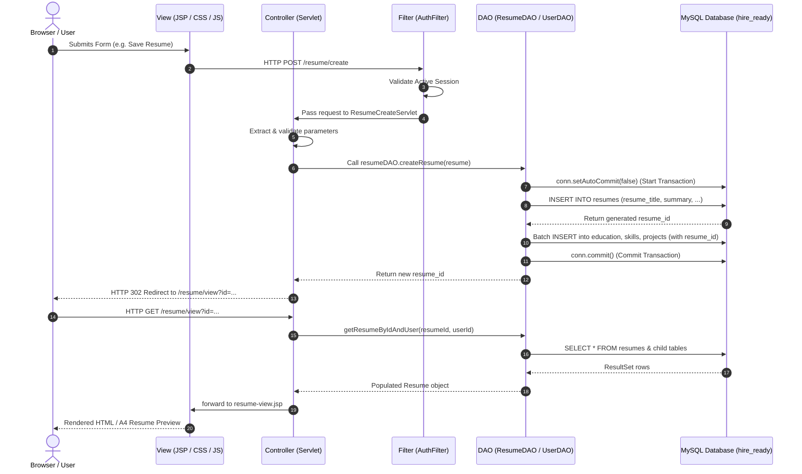
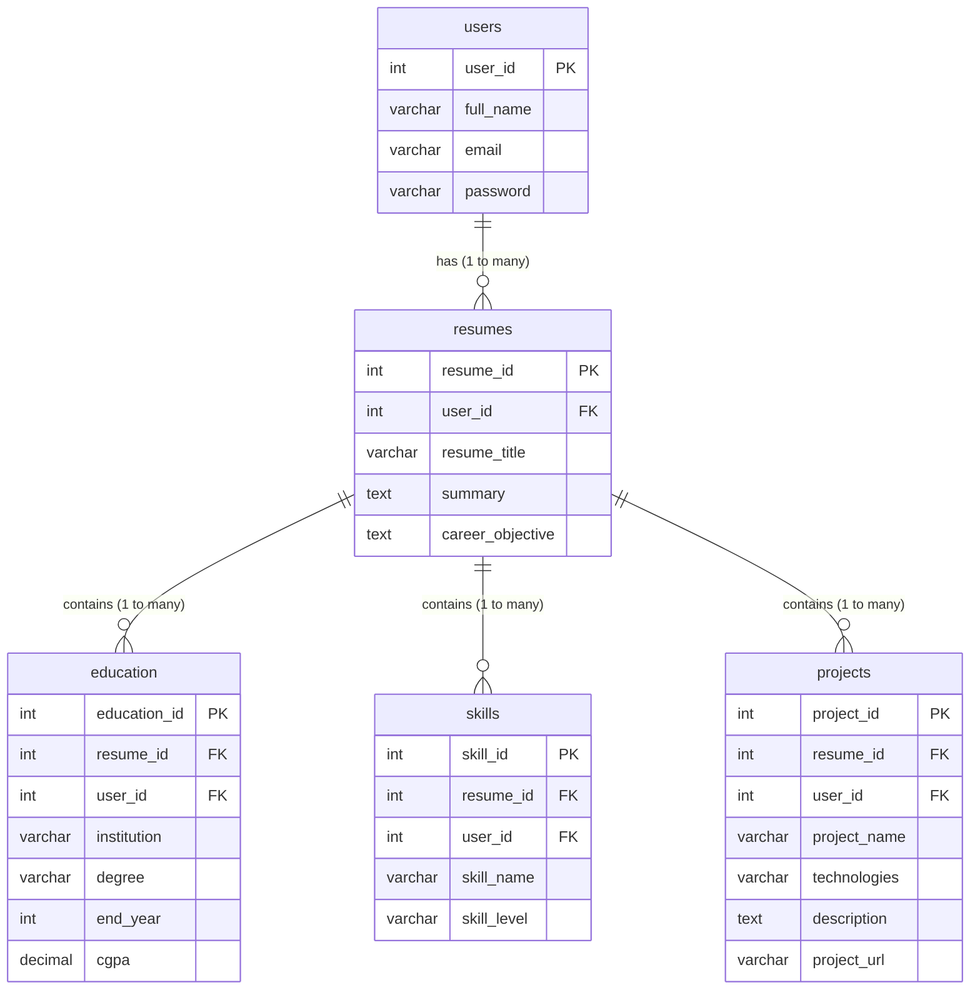

# HireReady — Online Resume Builder and Career System

**HireReady** is an online resume builder and candidate eligibility management system built using enterprise Java (**Jakarta Servlets**, **JSP**, **JDBC**), **MySQL**, and **Apache Tomcat 10.1**.

This document is a beginner-friendly project guide tailored for Computer Science Engineering students, presentations, and viva preparation.

---

## 1. Project Overview

### What is HireReady?
HireReady is a multi-tier web application that enables job seekers to create, edit, manage, and print structured, professional resumes. It also provides recruiters with an eligibility search filter to shortlist candidates based on criteria such as minimum CGPA, degree, skills, and graduation year.

### What Problem Does It Solve?
* **Formatting Hassles:** Freshers often struggle with inconsistent resume layouts across Word or static documents. HireReady standardizes resume inputs and renders them using a clean, print-ready CSS layout.
* **Recruiter Screening Overhead:** Instead of manually reviewing hundreds of PDF files, candidate qualifications are stored in a relational database, enabling fast, parameterized SQL searches.
* **Multiple Profiles:** A candidate can build and manage multiple distinct resumes (e.g., *Java Backend Developer* vs. *Frontend Specialist*) under a single account.

### Main Purpose & Implemented Features
* **User Authentication:** Registration with validation, duplicate email check, and BCrypt password encryption; secure session-based login and logout.
* **Resume Builder Form:** Unified form supporting dynamic, repeatable rows for Education, Skills, and Projects using vanilla JavaScript.
* **Transactional Persistence:** Saves resume headers and related child records inside an atomic database transaction using JDBC (`commit` / `rollback`).
* **Resume Preview & Print:** Authentic A4 paper presentation with `@media print` CSS rules that suppress browser navigation and buttons during one-click PDF printing.
* **Resume Management:** User dashboard showing all personal resumes with Preview, Edit, and Delete actions.
* **Candidate Eligibility Search:** Parameterized SQL search filtering resumes by minimum CGPA, degree, required skill, and graduation year.

---

## 2. Tech Stack

| Technology | Role in Project | Why We Use It |
|---|---|---|
| **Java (JDK 17 target / JDK 25)** | Core Backend Language | Strong type safety, multithreading, and platform independence. |
| **Jakarta Servlets 6.0** | Controller Layer | Handles HTTP GET/POST requests, session management, and routing. |
| **Jakarta JSP 3.1 & JSTL 3.0** | View Layer | Embeds dynamic data into HTML templates without messy Java scriptlets. |
| **HTML5 & CSS3** | Presentation & Layout | Semantic structure, responsive layouts, and `@media print` rules for A4 export. |
| **Vanilla JavaScript (ES6)** | Frontend Interactivity | Manages dynamic repeater rows (`addEducationRow()`, etc.) and print actions. |
| **JDBC (Java Database Connectivity)** | Data Access Tier | Direct, parameterized SQL communication via `PreparedStatement`. |
| **MySQL 8.0** | Relational Database | Stores normalized user and resume data with foreign key constraints. |
| **MySQL Connector/J (8.3.0)** | JDBC Driver | Client driver enabling Java to communicate over TCP port 3306 with MySQL. |
| **Apache Maven (3.9+)** | Build & Packaging Tool | Manages dependencies and packages the application into a `.war` file. |
| **Apache Tomcat 10.1** | Servlet Container | Provides the Jakarta EE 10 runtime environment (`jakarta.*` namespace). |
| **jBCrypt (0.4)** | Password Security | Secure, one-way salted password hashing for user accounts. |

---

## 3. Project Structure

```
HireReady-New/
├── pom.xml                             # Maven build configuration & dependencies
├── database.sql                        # Reference SQL script with sample data
├── PROJECT_DOCUMENTATION.md            # Exhaustive technical documentation file
├── README.md                           # This project guide & viva reference
├── src/
│   └── main/
│       ├── java/com/hireready/
│       │   ├── controller/             # Jakarta Servlets (Controllers)
│       │   │   ├── HomeServlet.java            # Landing page controller
│       │   │   ├── RegisterServlet.java        # Registration & duplicate email check
│       │   │   ├── LoginServlet.java           # Authentication & session creation
│       │   │   ├── LogoutServlet.java          # Session invalidation
│       │   │   ├── DashboardServlet.java       # User dashboard & resume stats
│       │   │   ├── ResumeCreateServlet.java    # Handles new resume creation
│       │   │   ├── ResumeEditServlet.java      # Handles resume editing & updates
│       │   │   ├── ResumeDeleteServlet.java    # Deletes resume (enforcing ownership)
│       │   │   ├── ResumeViewServlet.java      # Resume preview & print view
│       │   │   ├── ResumeListServlet.java      # List of user's resumes
│       │   │   ├── ResumeFilterServlet.java    # Candidate eligibility filtering
│       │   │   ├── AdminLoginServlet.java      # Admin portal login
│       │   │   ├── AdminDashboardServlet.java  # Admin user/resume console
│       │   │   ├── AdminResumeDeleteServlet.java # Admin resume moderation
│       │   │   ├── AdminUserDeleteServlet.java # Admin user deletion
│       │   │   └── AdminLogoutServlet.java     # Admin logout
│       │   ├── dao/                    # Data Access Objects (JDBC queries)
│       │   │   ├── UserDAO.java                # CRUD operations for users table
│       │   │   ├── ResumeDAO.java              # CRUD & transactions for resumes & child tables
│       │   │   └── AdminDAO.java               # Authentication for admins table
│       │   ├── filter/                 # Security interceptors
│       │   │   ├── AuthFilter.java             # Protects user routes (/dashboard, /resume/*)
│       │   │   └── AdminAuthFilter.java        # Protects admin routes (/admin/*)
│       │   ├── model/                  # Java POJOs (Entity models)
│       │   │   ├── User.java, Resume.java, Education.java, Skill.java,
│       │   │   ├── Project.java, Experience.java, Certification.java,
│       │   │   ├── Achievement.java, Admin.java, FilterCriteria.java
│       │   └── util/                   # Utility classes
│       │       ├── DBConnection.java           # JDBC connection factory (db.properties)
│       │       ├── PasswordUtil.java           # BCrypt password hashing & verification
│       │       └── ValidationUtil.java         # Email, password, and string sanitization
│       ├── resources/
│       │   └── db.properties           # MySQL connection URL, user, and password
│       └── webapp/                     # Frontend JSP, CSS, JS, and deployment files
│           ├── index.jsp                       # Landing home page
│           ├── register.jsp                    # Account registration form
│           ├── login.jsp                       # User login form
│           ├── dashboard.jsp                   # Candidate dashboard
│           ├── resume-form.jsp                 # Unified create/edit resume builder
│           ├── resume-view.jsp                 # A4 printable resume preview
│           ├── resume-list.jsp                 # Resumes overview table
│           ├── filter.jsp                      # Candidate eligibility search engine
│           ├── admin-login.jsp                 # Administrator login form
│           ├── admin-dashboard.jsp             # Administrator management console
│           ├── css/style.css                   # Theme styling, layout, & @media print rules
│           ├── js/main.js                      # Dynamic repeater rows & print helpers
│           ├── error/                          # 404.jsp and 500.jsp error handlers
│           └── WEB-INF/
│               ├── web.xml                     # Deployment descriptor (filters & error pages)
│               └── views/common/               # Shared navbar.jsp, footer.jsp, alerts.jsp
└── target/                             # Maven build artifacts (hireready.war)
```

---

## 4. Application Workflow

### Complete End-to-End Steps

1. **User Registration:** User fills out name, email, and password on `register.jsp`. `RegisterServlet` validates inputs, verifies the email is not registered (`UserDAO.isEmailRegistered`), hashes the password with BCrypt (`PasswordUtil.hashPassword`), and saves the account in the `users` table via `UserDAO.register`.
2. **User Login:** User enters email and password on `login.jsp`. `LoginServlet` invokes `UserDAO.findByEmail` and compares hashes via `PasswordUtil.verifyPassword`. On match, session attributes (`user`, `userId`, `userName`) are set and the browser is redirected to `/dashboard`.
3. **Opening Dashboard:** `DashboardServlet` reads the active session, queries `ResumeDAO.getResumesByUserId(userId)`, and forwards the list to `dashboard.jsp`.
4. **Creating a Resume:** User clicks "+ Create New Resume". `ResumeCreateServlet` (GET) renders `resume-form.jsp`. The user fills in title, summary, and clicks "+ Add Education", "+ Add Skill", "+ Add Project" (handled by `main.js` to create dynamic rows).
5. **Saving Resume in MySQL:** When the user clicks "Save Resume", `ResumeCreateServlet` (POST) parses fields and array inputs (`degree[]`, `institution[]`, etc.). It calls `ResumeDAO.createResume(resume)`. An atomic JDBC transaction (`conn.setAutoCommit(false)`) inserts the header into `resumes`, retrieves the generated `resume_id` via `Statement.RETURN_GENERATED_KEYS`, and executes batch inserts into `education`, `skills`, and `projects`. If successful, `conn.commit()` is called.
6. **Previewing the Resume:** Browser redirects to `/resume/view?id=X`. `ResumeViewServlet` checks user ownership (`ResumeDAO.getResumeByIdAndUser`), loads child collections, and forwards to `resume-view.jsp`. The user can click "Print / Save as PDF" which triggers `window.print()`.
7. **Editing or Deleting a Resume:**
   * *Edit:* `ResumeEditServlet` loads current data into `resume-form.jsp`. On submit, `ResumeDAO.updateResume` updates the header and executes `deleteChildRecords` before re-inserting updated child entries inside a transaction.
   * *Delete:* `ResumeDeleteServlet` verifies ownership and executes `DELETE FROM resumes WHERE resume_id = ? AND user_id = ?`. Foreign keys with `ON DELETE CASCADE` clean up child records.
8. **Candidate Eligibility Filtering:** User or recruiter visits `/filter`. `ResumeFilterServlet` passes criteria (CGPA, degree, skill, year) to `ResumeDAO.filterResumes`, which executes a dynamic, parameterized SQL query using subqueries and displays matches on `filter.jsp`.
9. **User Logout:** User clicks "Logout". `LogoutServlet` calls `session.invalidate()` and redirects to `login.jsp` with a success alert.

### Architecture Flowchart



---

## 5. How the Architecture Works

HireReady uses the standard **Model-View-Controller (MVC)** pattern with a dedicated **Data Access Object (DAO)** layer:

* **Model (POJOs):** Java classes (`User`, `Resume`, `Education`, `Skill`, `Project`) that act as data containers between the database and views. They hold attributes, constructors, getters, and setters.
* **View (JSP):** Presentation files (`dashboard.jsp`, `resume-form.jsp`, `resume-view.jsp`) that use standard HTML, CSS, and JSTL tags (`<c:forEach>`, `<c:if>`) to render data without raw Java code.
* **Controller (Servlets):** Java servlets (`ResumeCreateServlet`, `LoginServlet`) that receive HTTP requests, extract parameters, perform validation, invoke DAOs, and decide which view to render.
* **DAO (Data Access Objects):** Dedicated classes (`ResumeDAO`, `UserDAO`) containing all SQL queries. Controllers never execute raw SQL; they only call DAO methods.
* **Database (MySQL):** The persistence layer (`hire_ready` database) storing data in relational tables.

### Concrete Example: What happens when a user clicks "Save Resume"?
1. **View:** The user fills `resume-form.jsp` and clicks submit. Browser sends a POST request with form fields and array parameters (`degree[]`, `institution[]`, etc.).
2. **Controller:** `ResumeCreateServlet` receives the POST request. It validates that mandatory fields (title, degree) are non-empty, creates a `Resume` object, and builds lists of `Education`, `Skill`, and `Project` objects.
3. **DAO:** `ResumeCreateServlet` invokes `resumeDAO.createResume(resume)`.
4. **Database & Transaction:** `ResumeDAO` turns off auto-commit (`conn.setAutoCommit(false)`). It inserts into `resumes`, retrieves the generated `resume_id`, and executes batch prepared statements to insert each education, skill, and project row tagged with `resume_id`. If successful, it commits; if an error occurs, it rolls back.
5. **Response:** The servlet redirects the browser to `/resume/view?id=generatedId`, where `ResumeViewServlet` fetches the newly created record and renders the preview.

---

## 6. Database Overview

* **Active Database Name:** `hire_ready` (Configured in `src/main/resources/db.properties`).
* **Database Engine:** MySQL 8.0 with InnoDB (supporting foreign keys and transactions).

### Implemented Tables & Relationships



### Table Descriptions
1. **`users`:** Stores login credentials. Primary Key: `user_id`. Important columns: `full_name`, `email` (UNIQUE), `password` (BCrypt hash), `created_at`.
2. **`resumes`:** Stores resume headers. Primary Key: `resume_id`. Foreign Key: `user_id` referencing `users(user_id)`. Important columns: `resume_title`, `summary`, `career_objective`, `updated_at`.
3. **`education`:** Stores qualifications. Primary Key: `education_id`. Foreign Key: `resume_id` referencing `resumes(resume_id)` (`ON DELETE CASCADE`). Columns: `institution`, `degree`, `end_year`, `cgpa`.
4. **`skills`:** Stores candidate skills. Primary Key: `skill_id`. Foreign Key: `resume_id` referencing `resumes(resume_id)` (`ON DELETE CASCADE`). Columns: `skill_name`, `skill_level`.
5. **`projects`:** Stores portfolio projects. Primary Key: `project_id`. Foreign Key: `resume_id` referencing `resumes(resume_id)` (`ON DELETE CASCADE`). Columns: `project_name`, `technologies`, `description`, `project_url`.
6. **`jobs` & `job_requirements`:** Present in the schema as planned recruitment tables (currently 0 rows).

### Clarification on `resume_id` vs. `user_id`
* **Historical Issue:** In earlier versions, child tables (`education`, `skills`, `projects`) were linked only to `user_id`. When a user had multiple resumes, qualifications from all resumes bled into one another, creating duplicate rows and corrupted updates.
* **Current Implementation:** Verified in code and schema: `education`, `skills`, and `projects` now have `resume_id` columns with foreign keys (`fk_edu_resume`, `fk_skill_resume`, `fk_proj_resume`). `ResumeDAO` queries child records strictly by `WHERE resume_id = ?`, keeping resumes completely distinct.

---

## 7. How to Run the Project

### Prerequisites
* JDK 17 or higher installed.
* Apache Maven 3.8+ installed.
* MySQL 8.0 running locally on port 3306.
* Apache Tomcat 10.1 installed.

### Commands (Windows PowerShell)

#### Step 1: Navigate to Project Directory
```powershell
cd C:\Users\simra\OneDrive\Desktop\HireReady-New
```

#### Step 2: Build with Maven
```powershell
mvn package
```
*Output WAR location:* `C:\Users\simra\OneDrive\Desktop\HireReady-New\target\hireready.war`

#### Step 3: Stop Tomcat Service
```powershell
Stop-Service Tomcat10
```

#### Step 4: Deploy WAR to Tomcat
```powershell
# Deploy as HireReadyApp.war so URL matches /HireReadyApp
Copy-Item "target\hireready.war" "C:\Program Files\Apache Software Foundation\Tomcat 10.1\webapps\HireReadyApp.war" -Force
```

#### Step 5: Start Tomcat Service
```powershell
Start-Service Tomcat10
```

#### Step 6: Access Application
Open your browser and navigate to:
```
http://localhost:8080/HireReadyApp/
```

---

## 8. Important Problems and Fixes

| Issue Encountered | Root Cause | Fix Applied | Status |
|---|---|---|---|
| **SQL Error: Unknown column 'name'** | `UserDAO` queried `name`, but MySQL table column is `full_name`. | Corrected SQL queries in `UserDAO` to use `full_name`. | **FIXED & VERIFIED** |
| **SQL Error: Unknown column 'title'** | `ResumeDAO` queried `title`, but MySQL column is `resume_title`. | Corrected SQL in `ResumeDAO` to use `resume_title`. | **FIXED & VERIFIED** |
| **Duplicate Child Records Across Resumes** | Child tables only referenced `user_id`, causing all user's entries to appear in every resume. | Added `resume_id` column and foreign keys; updated queries to filter strictly by `resume_id`. | **FIXED & VERIFIED** |
| **Stale Resume Data on Browser Back/Edit** | Browser cached HTTP GET responses for preview pages. | Added `Cache-Control: no-cache, no-store, must-revalidate` headers in servlets and `AuthFilter`. | **FIXED & VERIFIED** |
| **Target Folder Locking on `mvn clean`** | VS Code Language Server or Windows Explorer locks `target\test-classes`. | Run `mvn package` directly without `clean`, or close locking process. | **FIXED IN WORKFLOW** |
| **Blank Contact Info in Resume Preview** | `resumes` table in `hire_ready` lacks contact columns (`full_name`, `email`, `phone`), initialized as `""` in DAO. | Contact info currently blank on preview. Requires joining `users` or adding columns to `resumes`. | **KNOWN ISSUE** |
| **Missing Tables (Experience, Certs, Achievements)** | Tables do not exist in live `hire_ready` database; DAO methods are no-ops. | Form fields exist in UI but data is not saved to DB until tables are created. | **KNOWN ISSUE** |
| **Admin Login Fails** | `admins` table does not exist in `hire_ready` database. | Accessing `/admin/login` errors unless `admins` table is created in MySQL. | **KNOWN ISSUE** |

---

## 9. Current Project Status

### What is Working
* Complete User Registration, Login, and Session Logout with BCrypt password encryption.
* Route protection with `AuthFilter`.
* Resume creation with dynamic multi-row inputs for Education, Skills, and Projects.
* Transactional saving with generated keys and cascade deletion.
* A4 printable resume preview with clean print formatting (`@media print`).
* Resume edit, update, and delete with ownership security checks.
* Multi-criteria candidate eligibility filtering.

### What Needs Manual Browser Testing
* Full end-to-end UI verification across edge cases (empty strings, non-numeric CGPA, special characters).

### Known Limitations
* Contact details (Name, Email, Phone, LinkedIn) on the preview page render blank because the `resumes` table in `hire_ready` lacks these columns and the DAO does not yet join the `users` table.
* Work Experience, Certifications, and Achievements are not saved to MySQL because their corresponding tables have not been created in `hire_ready`.

---

## 10. Future Improvements

1. **Populate Contact Details in Resume Preview:** Update `ResumeDAO.mapResumeHeader` to perform an `INNER JOIN users ON resumes.user_id = users.user_id` so the candidate's real name and email automatically appear on the preview.
2. **Create Missing Schema Tables:** Add `experience`, `certifications`, and `achievements` tables to `hire_ready` so all form sections persist.
3. **Setup Admin Authentication Table:** Create the `admins` table in `hire_ready` so the moderation dashboard can be utilized.
4. **Resume Templates:** Introduce selectable CSS themes (Modern, Minimalist, Corporate) on the preview page.

---

## 11. Viva Preparation

### Top 10 Viva Questions & Answers

#### Q1: What architecture does HireReady follow?
**Answer:** HireReady follows the **Model-View-Controller (MVC)** architecture along with the **DAO (Data Access Object)** pattern. Servlets act as Controllers, JSP files act as Views, Java POJOs represent the Model, and DAO classes isolate JDBC database operations.

#### Q2: Why did you use Jakarta Servlets and JSP instead of Spring Boot?
**Answer:** Using core Jakarta Servlets and JSP demonstrates a clear, foundational understanding of the HTTP request-response lifecycle, manual session tracking, Servlet Filters, and direct JDBC transaction handling without depending on automated framework abstractions.

#### Q3: Why is Apache Tomcat 10.1 required and not Tomcat 9?
**Answer:** Tomcat 10.1 implements **Jakarta EE 10**, which uses the modern `jakarta.*` package namespace (`jakarta.servlet.*`). Tomcat 9 uses the older Java EE standard with the legacy `javax.*` namespace. HireReady uses Jakarta EE 10 packages and therefore requires Tomcat 10.1+.

#### Q4: What is the purpose of `PreparedStatement` and why is it preferred over `Statement`?
**Answer:** `PreparedStatement` pre-compiles SQL queries and uses parameterized placeholders (`?`). This provides two main benefits:
1. **Security:** It completely prevents SQL Injection attacks by treating input purely as data rather than executable code.
2. **Performance:** The database engine reuses the execution plan for repeated queries.

#### Q5: How does HireReady handle database transactions during resume creation?
**Answer:** In `ResumeDAO.createResume`, auto-commit is disabled using `conn.setAutoCommit(false)`. The resume header is inserted, the generated `resume_id` is retrieved, and child records are inserted in batches. If all operations succeed, `conn.commit()` is called. If any exception occurs, `conn.rollback()` executes so no incomplete or orphan data remains in the database.

#### Q6: How was the duplicate resume data problem solved?
**Answer:** Previously, child tables (`education`, `skills`, `projects`) were linked only to `user_id`, meaning every resume created by a user loaded all of that user's qualifications. We resolved this by adding a `resume_id` foreign key column to all child tables and updating DAO queries to filter strictly by `WHERE resume_id = ?`.

#### Q7: How does password security work in this project?
**Answer:** Passwords are never stored in plain text. When a user registers, `PasswordUtil.hashPassword` uses **BCrypt** with 10 cryptographic salt rounds (`jbcrypt`). During login, `PasswordUtil.verifyPassword` verifies the plain password against the stored BCrypt hash.

#### Q8: How does user authorization / ownership checking work when viewing or editing a resume?
**Answer:** To prevent users from viewing or tampering with another candidate's resume by guessing the URL ID (e.g., `/resume/edit?id=5`), `ResumeDAO.getResumeByIdAndUser(resumeId, userId)` includes both `resume_id` and the logged-in user's `userId` in the `WHERE` clause (`WHERE resume_id = ? AND user_id = ?`). If the resume does not belong to the user, the query returns null and access is denied.

#### Q9: How does HireReady export resumes to PDF?
**Answer:** Instead of using heavy third-party PDF libraries, HireReady uses native browser printing combined with CSS `@media print` rules. In print mode, all navigation bars, buttons, and alert messages are hidden (`display: none !important`), and the resume container reformats as a standard A4 sheet. Clicking "Print / Save as PDF" calls JavaScript's `window.print()`.

#### Q10: What is the purpose of `AuthFilter`?
**Answer:** `AuthFilter` is a Servlet Filter intercepting requests to protected URL patterns (`/dashboard`, `/resume/*`, `/filter`). It checks if a valid session attribute (`user`) exists. If not, it redirects the visitor to `/login.jsp`. It also injects `Cache-Control` headers so logged-out users cannot see sensitive data by pressing the browser back button.

---

### Maintenance Note
For an exhaustive, multi-section technical breakdown including line-by-line class explanations, database schemas, and deep troubleshooting details, refer to [`PROJECT_DOCUMENTATION.md`](file:///c:/Users/simra/OneDrive/Desktop/HireReady-New/PROJECT_DOCUMENTATION.md).
